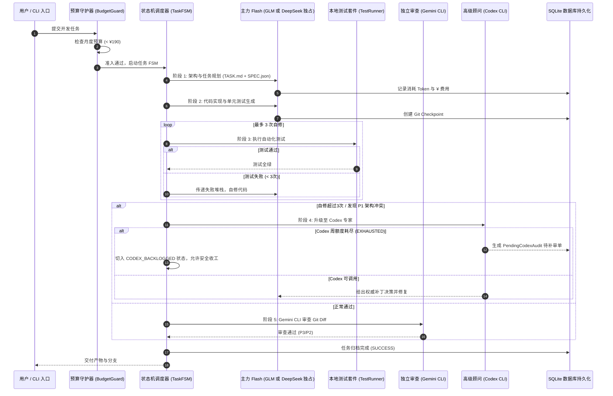

# AgentCooperation: 全自动多 Agent 协同编排引擎

[](https://www.python.org/downloads/)
[]()
[]()

基于 **GLM-5.3-Flash / DeepSeek-Flash 原生 API** + **Gemini CLI 独立审查** + **Codex CLI 专家兜底** 的全自动端到端软件开发调度系统。

---

## 一、核心架构原则与设计哲学

1. **主力 Flash 引擎同位互斥（二选一贯穿闭环）**
   - **`GLM-5.3-Flash`** 与 **`DeepSeek-Flash`** 在系统中**承担完全相同的角色**（主力开发、测试自修）。
   - **架构铁律**：在任何单个任务的生命周期中，**只激活其中一个引擎贯穿始终**，绝不在同一进程或上下文中串联/级联两个 Flash 模型，杜绝幻觉传递与重复 Token 损耗。

2. **API 与本地 CLI 混合双轨调度**
   - **主力研发模型**：走原生 **OpenAI-Compatible 异步 API** 调用，精准捕获 `usage.prompt_tokens` 与 `completion_tokens`，实现 100% 准确的阶梯预算控制（¥200/月）。
   - **独立审查与专家顾问**：调用本地已登录订阅的 **Gemini CLI** 与 **Codex CLI**，不消耗 API 费用。

3. **零 Token 开销的确定性有限状态机（FSM）**
   - 基于成熟轻量级 `pytransitions` 引擎，由纯 Python 控制任务流转（`PLANNING -> DEVELOPING -> TESTING -> REPAIRING -> REVIEWING -> ESCALATING -> SUCCESS`），核心编排不耗费任何模型 Token。

4. **Codex 周额度优雅降级与延期补审机制**
   - **拒绝盲目中断**：当 Codex 本地 CLI 遇到周额度耗尽（`EXHAUSTED`）时，系统自动将重大架构争议持久化至 SQLite `PendingCodexAudit` 待补审单中。
   - **保障主线收敛**：让 Gemini CLI 与主力 Flash 先行完成安全可控的工作，任务正常收尾并打上待补审标记。
   - **恢复后闭环**：周额度重置后，通过后台看门狗自动重试处理历史补审单。

5. **物理隔离与 Git Worktree 检查点**
   - 各任务拥有独立 Git Worktree 工作空间与专属分支，修改与破坏性实验互不干扰。
   - 每次代码生成与自修自动创建 Git Commit 检查点，支持测试失败后的硬回滚。

---

## 二、架构流程时序图



---

## 三、目录结构

```
e:\AgentCooperation\
├── config/                  # 系统策略与环境配置
│   ├── policy.yaml          # 定价、额度阈值、超时与模型规则
│   └── settings.py          # Pydantic 校验与环境加载
├── agents/                  # 统一 Agent 适配层 (API + CLI 混合)
│   ├── base.py              # 抽象基类与 AgentResult
│   ├── flash_api.py         # GLM-5.3-Flash & DeepSeek-Flash 异步 API
│   ├── gemini_reviewer.py   # Gemini CLI 子进程审查器
│   ├── codex_expert.py      # Codex CLI 专家与周额度检测
│   └── opencode_runner.py   # OpenCode CLI 可选终端沙箱运行器
├── orchestrator/            # 调度编排核心中枢
│   ├── engine_selector.py   # 单引擎槽位互斥守卫
│   ├── fsm.py               # pytransitions 状态机
│   ├── budget_guard.py      # ¥200/月 阶梯预算守护器
│   ├── codex_guard.py       # Codex Quota 状态机与待补审队列
│   ├── core.py              # 全流程自动化驱动核心
│   └── cli.py               # Rich 交互式终端入口
├── execution/               # 进程与沙箱环境控制
│   ├── subproc.py           # 非交互防卡死、ANSI 清洗与看门狗
│   ├── worktree.py          # Git Worktree 隔离与检查点回退
│   └── test_runner.py       # 自动化测试探查与执行 (pytest/npm)
├── storage/                 # 持久化存储 (SQLite + SQLModel)
│   ├── models.py            # Task, ExecutionLog, PendingCodexAudit
│   └── db.py                # 数据库 Session 与初始化
├── references/              # 精选开源参考代码仓库
│   ├── transitions/         # 有限状态机底层参考
│   ├── cli-agent-orchestrator/ # CLI 子进程调度模式参考
│   └── multi-agent-code-review/ # 代码审查契约参考
└── tests/                   # 100% 覆盖的核心自动化测试套件
```

---

## 四、快速安装与配置

### 1. 安装依赖
```bash
pip install -r requirements.txt
```

### 2. 配置环境变量（可选）
在工程根目录创建 `.env` 文件：
```ini
# 主力 API 密钥（二选一或全部配置）
GLM_API_KEY="your-zhipu-api-key"
DEEPSEEK_API_KEY="your-deepseek-api-key"

# 本地 CLI 命令别名（若已加入系统 PATH 则无需修改）
GEMINI_CLI_CMD="gemini"
CODEX_CLI_CMD="codex"
```

---

## 五、CLI 命令行工具使用指南

### 1. 查看系统运行状态与预算
```bash
python -m orchestrator.cli status
```
* 输出月度累计 Token 消耗、¥ 支出（对比 ¥200 上限）以及 Codex 当前额度状态。

### 2. 启动自动化开发任务
```bash
# 使用默认 GLM 引擎进行真实开发
python -m orchestrator.cli run --task "开发一个高并发安全的线程安全LRU缓存模块，包含单元测试" --model glm

# 切换为 DeepSeek 引擎进行开发
python -m orchestrator.cli run --task "实现二叉搜索树并编写测试" --model deepseek

# 离线演练 / Mock 模式（不消耗 API 费用）
python -m orchestrator.cli run --task "模拟全生命周期测试" --mock
```

### 3. 查看任务执行历史
```bash
python -m orchestrator.cli tasks
```

### 4. 触发 Codex 周额度恢复后的补审处理
```bash
python -m orchestrator.cli codex-backlog
```

---

## 六、自动化测试验证

运行完整的单元测试与端到端测试套件：
```bash
pytest tests/ -v
```
所有测试均包含内存数据库隔离与独立状态机断言，开箱即用。
